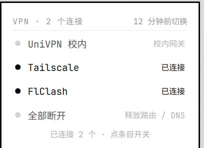

# VPN Switch for Omarchy

[](https://github.com/Shawnicsc/vpn-switch/actions/workflows/ci.yml)
[](LICENSE)

A conflict-aware VPN and proxy switcher for the [Omarchy](https://omarchy.org/)
bar. Unlike a one-at-a-time switcher, it keeps compatible providers online
together: Tailscale can stay connected while you use a tunnel or a system
proxy, and you can switch each provider independently.



## Features

- **Multiple connections at once.** Toggle each provider independently instead
  of disconnecting everything first.
- **Conflict-aware.** `tunnel + proxy` and Tailscale's `overlay` mode are
  allowed; two tunnels, two system proxies, or two unknown route-taking apps
  are blocked with a clear notification.
- **Automatic discovery.** Finds installed VPN/proxy apps from a curated binary
  list and from `.desktop` files, so new installs appear and uninstalled apps
  disappear. Results are cached for 30 seconds and can be rescanned manually.
- **Built-in providers.** UniVPN, Tailscale, FlClash, Clash Verge, Mihomo,
  sing-box, Hiddify, NekoRay/NekoBox, Mullvad, NordVPN, Proton VPN, WireGuard,
  OpenVPN, OpenConnect, and v2rayA.
- **Omarchy-native UI.** A bar widget with a popup panel, multi-connection
  summary, per-row conflict hints, and a "disconnect all" row.
- **Optional menu rows** for the Omarchy menu, plus a CLI for scripts.

## Requirements

- Omarchy with the Quickshell-based shell. Tested on Omarchy **4.5.0-3** with
  Quickshell **0.3.2**.
- `bash`, `jq`, `iproute2` (`ip`), and `procps` (`pgrep`/`pkill`). Omarchy
  ships all of them.
- Any VPN/proxy apps you want to control. They are optional: the panel simply
  lists what is installed.
- No elevated privileges are needed for the plugin itself. Some providers
  (WireGuard, OpenVPN, v2rayA) are detection-only because starting or stopping
  them needs a configuration file or a service manager.

## Install

### Option A — Omarchy plugin (recommended, bar widget only)

```bash
omarchy plugin add https://github.com/Shawnicsc/vpn-switch.git --enable
```

This installs the widget as `io.github.shawnicsc.vpn` and places it in the
right bar section by default. The bundled CLI is invoked by the widget, so no
extra setup is needed. Add menu rows or a global `vpn-switch` command only if
you want them (see Option B).

The plugin lives at:

```text
~/.config/omarchy/plugins/io.github.shawnicsc.vpn/
├── BarWidget.qml
├── bin/vpn-switch
└── manifest.json
```

Update it with `omarchy plugin update io.github.shawnicsc.vpn`. Remove it with
`omarchy plugin remove io.github.shawnicsc.vpn`.

### Option B — full install (CLI + custom bar module + optional menu)

Use this if you want `vpn-switch` on `PATH` and the Omarchy menu rows:

```bash
git clone https://github.com/Shawnicsc/vpn-switch.git
cd vpn-switch
./install.sh --with-menu
```

The installer:

- copies `bin/vpn-switch` to `~/.local/bin/vpn-switch`;
- copies `BarWidget.qml` to `~/.config/omarchy/bar/modules/vpn.qml` and adds
  `{"id":"vpn","type":"qml"}` to `bar.layout.right` in `shell.json` (if it is
  not already there);
- with `--with-menu`, merges the VPN rows from
  `extras/omarchy-menu.jsonc.fragment` into
  `~/.config/omarchy/extensions/omarchy-menu.jsonc`;
- backs up every config file it edits and restarts the shell.

Useful flags: `--no-restart`, `--dry-run`, `--help`.

Do **not** install Option A and Option B together unless you want two bar
widgets: they use different widget IDs (`io.github.shawnicsc.vpn` and `vpn`).

## Usage

Click the shield icon in the bar to open the panel, then click a row to toggle
that provider. The panel shows every discovered provider, what is connected,
and which rows would conflict with a running provider. "全部断开 / Disconnect
all" turns everything off.

### CLI

```bash
vpn-switch panel                # JSON used by the bar widget
vpn-switch list                 # discovered providers, mode, and state
vpn-switch status               # connected IDs, or "off"
vpn-switch toggle <id>          # toggle one provider
vpn-switch on <id> [--force]    # start one; refuse conflicts by default
vpn-switch off [id]             # stop one, or everything with no id
vpn-switch set <id>             # exclusive mode (stop all others)
vpn-switch cycle                # exclusive rotation
vpn-switch refresh              # rescan installed apps now
vpn-switch version
```

Plugin-only users can call the bundled script directly:

```bash
~/.config/omarchy/plugins/io.github.shawnicsc.vpn/bin/vpn-switch list
```

### Conflict model

Each provider is classified as one of:

| Mode | Meaning | Conflicts with |
| --- | --- | --- |
| `overlay` | Tailscale without an exit node | nothing |
| `tunnel` | UniVPN, TUN-mode Clash, WireGuard, VPN clients | other tunnels and unknown apps |
| `proxy` | Clash/FlClash/Mihomo in system-proxy mode | other proxies and unknown apps |
| `unknown` | Auto-discovered apps whose mode cannot be inferred | everything except overlay |

`tunnel + proxy` is deliberately allowed (a proxy over a VPN tunnel is a normal
setup). Tailscale in exit-node mode is treated as a tunnel. FlClash and Clash
Verge TUN mode is read from their generated config and from the live TUN
interface, so a TUN-enabled Clash is not treated as a harmless system proxy.

### Automatic discovery

The list is rebuilt at most every 30 seconds, or immediately with
`vpn-switch refresh`:

1. Curated binaries are probed with `command -v` / known paths.
2. `.desktop` files in the system, user, and Flatpak application directories
   are matched on VPN/proxy keywords.

Uninstalled apps disappear on the next scan. Desktop entries without a usable
`Exec=` line and Flatpak/shell wrappers are skipped rather than guessed.

## Remove

Full install:

```bash
cd vpn-switch
./uninstall.sh
```

Plugin install:

```bash
omarchy plugin remove io.github.shawnicsc.vpn
```

The uninstaller only removes files it created, the `vpn` bar layout entry, and
its marked menu block. Backups are left beside each edited config file.

## Security and privacy

- Everything runs locally. There is no network code, telemetry, or background
  daemon.
- The widget executes only the bundled `bin/vpn-switch` script (or the
  `vpn-switch` command on `PATH` in the full install).
- The plugin never edits user configuration by itself. `install.sh` edits
  `shell.json` and (only with `--with-menu`) the Omarchy menu file, with backups
  and an explicit `--with-menu` opt-in.
- Like every Omarchy plugin, it runs unsandboxed inside `omarchy-shell`. Read
  the script before installing if you are not the author.

## Development

```bash
./scripts/validate.sh
```

The validation script checks the manifest, entry point, executable bit, shell
syntax, Python syntax, version consistency, and (when available) `shellcheck`
and `omarchy-plugin-validate`. CI runs it on every push and pull request; a
`v*` tag creates a GitHub Release with `tar.gz` and `.zip` archives.

Release steps are documented in [docs/RELEASING.md](docs/RELEASING.md).

## 中文说明

这是 Omarchy 状态栏的 VPN / 代理切换插件。和“先全关再开一个”的旧工具不同，
它允许**互不冲突的 VPN 同时在线**：

- Tailscale overlay 可以和隧道、系统代理共存；
- 隧道 + 系统代理允许共存；
- 两个隧道、两个系统代理或两个无法判断路由模式的应用会被阻止并提示；
- 已安装的 UniVPN、Tailscale、FlClash、Clash Verge、Mihomo 等会自动发现，
  新装出现、卸载消失，30 秒缓存，也可以手动重扫。

点状态栏盾牌图标打开面板，点条目开关；"全部断开"会关闭所有项。

安装：

```bash
omarchy plugin add https://github.com/Shawnicsc/vpn-switch.git --enable
```

需要命令行和 Omarchy 菜单时：

```bash
git clone https://github.com/Shawnicsc/vpn-switch.git
cd vpn-switch
./install.sh --with-menu
```

卸载：`omarchy plugin remove io.github.shawnicsc.vpn`，或运行
`./uninstall.sh`。

## License

MIT. See [LICENSE](LICENSE).
